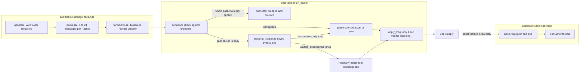
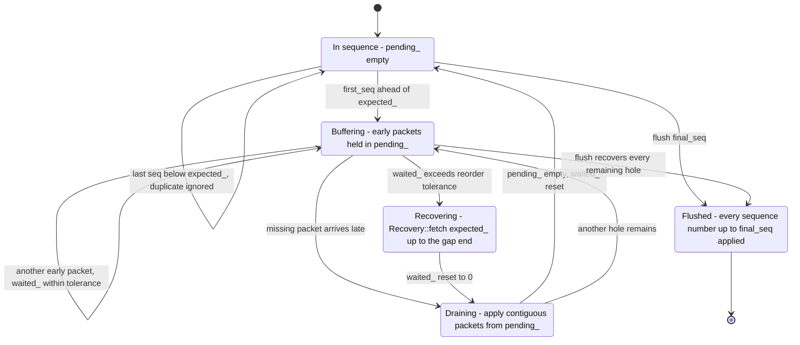
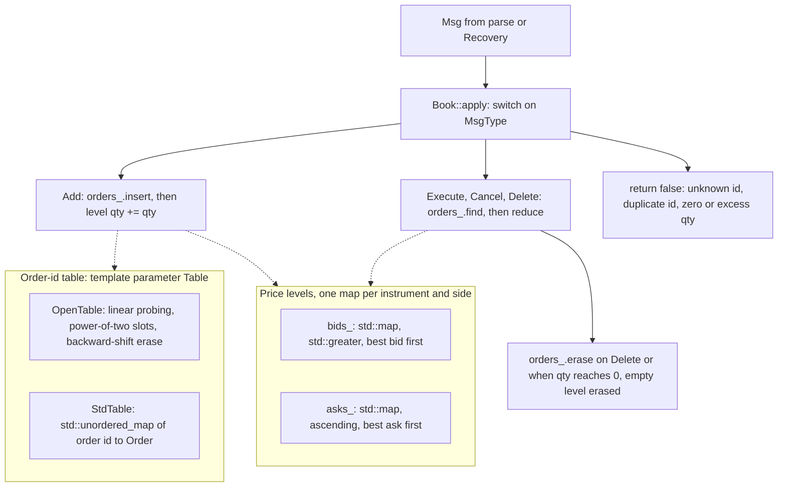
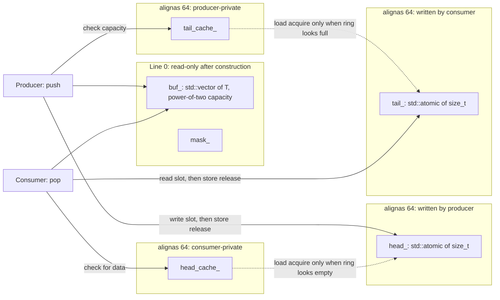

# Tickscope

[](https://github.com/ombdj1209/tickscope/actions/workflows/ci.yml)

**A market-data feed handler you can measure.** A synthetic ITCH-inspired binary feed with packet loss, duplication and reordering. The C++20 pipeline has a zero-copy parser, a price-level order book with a preallocated open-addressing order table, gap detection with retransmission recovery, a lock-free SPSC queue and a log-linear latency histogram. A benchmark matrix explains where the nanoseconds go and what each design choice buys.

The protocol is ITCH-*inspired*: fixed-size little-endian messages (add, execute, cancel, delete) with per-message sequence numbers. It is not NASDAQ ITCH 5.0. The feed is synthetic, and nothing here trades.

## At a glance

- **Parser:** 14.9 ns per message (67.1 M messages/s), zero-copy over `std::span`; one heap allocation per message costs 72.2 ns.
- **Order book:** open-addressing order table with backward-shift deletion, p99.9 of 800 ns against 1,312 ns for `std::unordered_map`, and the same book (same state hash).
- **End to end, one thread:** 7.1 M messages/s; per packet p50 512 ns, p99 3.1 µs, p99.9 14.0 µs.
- **Recovery:** from 0% to 5% packet loss with duplicates and reordering, every run rebuilds a book identical to the lossless replay. A reorder tolerance of 4 packets removes 98% of retransmit requests when there is no loss.
- **Correctness:** 8 dependency-free tests, run optimised, under AddressSanitizer + UndefinedBehaviorSanitizer, and under ThreadSanitizer.
- **Honesty:** all numbers come from one run on a 1-core cloud VM, recorded in [`results/results.json`](results/results.json). The thread-handoff numbers are scheduler measurements on that machine, not cache-coherence measurements.

## Tech stack

| Layer | Technology | Used for |
|---|---|---|
| Language | C++20 (`-std=c++20`), header-only library plus two translation units | The whole codebase; no third-party libraries |
| C++20 library | `std::span` (`<span>`) | Non-owning view over packet bytes; `parse` reads from it and the handler advances with `subspan` |
| C++20 library | `std::bit_width` (`<bit>`) | Histogram bucket index (position of the highest set bit) |
| Concurrency | `std::atomic<std::size_t>` (`<atomic>`) with explicit `memory_order_relaxed`, `_acquire` and `_release` | SPSC ring head and tail indices |
| Memory layout | `alignas(kCacheLine)` with `kCacheLine = 64` | Puts each SPSC index and each cached peer index on its own cache line |
| Threads and locking | `<thread>`, `<mutex>`, `<condition_variable>` | Producer threads in tests and benchmark; `MutexQueue` baseline |
| Containers | `<vector>`, `<map>`, `<unordered_map>`, `<deque>`, `<array>`, `<optional>` | Order-table storage, price levels, out-of-order packet buffer, `StdTable`, mutex queue, histogram counts, best bid and ask |
| Bytes and scalars | `<cstring>` (`std::memcpy`), `<cstddef>` (`std::byte`), `<cstdint>` | Alignment-safe wire loads and stores |
| Randomness | `<random>` (`std::mt19937_64`) | Deterministic order-flow generator, packetizer and fault injection |
| Algorithms | `<algorithm>`, `<functional>` (`std::greater<>`) | Packet sizing, reorder swaps, bid-side ordering |
| Timing | `<chrono>` (`std::chrono::steady_clock`) | All benchmark timestamps |
| I/O | `<cstdio>`, `<fstream>`, `<sstream>`, `<string>` | Test and benchmark output, reading `/proc/cpuinfo`, writing `results/results.json` |
| Memory | `<memory>` (`std::unique_ptr`) | The heap-allocation-per-message parser baseline |
| Compiler extension | GNU extended `asm volatile("" : : "g"(v) : "memory")` | `keep()`, an optimisation barrier so benchmarked work is not eliminated |
| POSIX | `<unistd.h>` (`sysconf(_SC_NPROCESSORS_ONLN)`) | Reporting the online core count in benchmark output |
| Build | GNU Make | `test`, `asan`, `tsan`, `bench`, `clean` targets |
| Compilers | GCC (g++ 13.3 for the published results), Clang | Build; CI runs both |
| Sanitizers | AddressSanitizer + UndefinedBehaviorSanitizer (`-fsanitize=address,undefined`) | Memory-safety and UB checks over the full test suite |
| Sanitizers | ThreadSanitizer (`-fsanitize=thread`) | Data-race checks, chiefly the cross-thread SPSC test |
| CI | GitHub Actions (GCC and Clang, ASan/UBSan and TSan jobs), Dependabot for GitHub Actions | `make test` with g++ and clang++; sanitizer jobs with clang++; monthly action updates |

Not used, deliberately: concepts (the order-table parameter `Table` is duck-typed), `std::bit_cast` (field loads use `std::memcpy`) and `std::hardware_destructive_interference_size` (the cache-line size is a fixed 64-byte constant).

## Why this exists

IMC's Amsterdam C++ execution teams build software in the latency-critical loop: exchange connectivity, real-time processing of market data, and hardware integration where software alone is not fast enough, while balancing latency, throughput, simplicity and testability. Tickscope is a small, honest version of the first stage of that loop, built to show the engineering habits that matter there:

- measure before optimising;
- prove correctness under failure;
- report the tail, not the mean;
- say exactly what hardware the numbers came from.

## Architecture

### Data path

Packets are UDP-datagram-shaped (`Packet`: first sequence number, message count, contiguous bytes) but the transport is in memory. The SPSC ring is implemented and benchmarked as a separate stage; it is not wired between the handler and a consumer in this repository.



| Piece | File |
|---|---|
| Wire format, encoder, bounds-checked zero-copy parser | `include/tickscope/protocol.hpp` |
| Order book, open-addressing table with backward-shift deletion, `std::unordered_map` table | `include/tickscope/book.hpp` |
| Feed generator, packetizer, fault injection, recovery service, feed handler | `include/tickscope/feed.hpp` |
| Lock-free SPSC ring (cache-line separated indices, cached peer index) and mutex queue | `include/tickscope/spsc.hpp` |
| HDR-style latency histogram | `include/tickscope/histogram.hpp` |
| Benchmark matrix, tests | `src/bench.cpp`, `src/tests.cpp` |

### Gap recovery

`FeedHandler` has no explicit state enum; its state is implied by `pending_` (early packets, keyed by first sequence number), `waited_` (early packets seen since the last reset) and `expected_` (next sequence number to apply). The states below are named from those fields.



Recovery requests cover `expected_` up to one before the lowest buffered `first_seq`. Because `apply_msg` applies a message only when `seq == expected_`, a late original that overlaps a retransmitted range is harmless: already-applied messages inside it are skipped.

### Order book

`Book<Table>` is generic over the order-id table so allocation strategies can be swapped and benchmarked against an identical workload.



`state_hash()` is FNV-1a over every (instrument, side, price, quantity) level, so "the book is correct" reduces to one integer comparison against a lossless replay.

### SPSC ring layout



## Repository layout

```text
.
├── .github/
│   ├── dependabot.yml          # monthly, grouped GitHub Actions updates
│   └── workflows/ci.yml        # g++ and clang++ tests; ASan/UBSan and TSan jobs
├── include/tickscope/
│   ├── protocol.hpp            # wire format, encode, parse, Msg, Packet
│   ├── book.hpp                # Order, OpenTable, StdTable, Book<Table>
│   ├── feed.hpp                # generate, packetize, transmit, Recovery, FeedHandler<Table>
│   ├── spsc.hpp                # Spsc<T>, MutexQueue<T>
│   └── histogram.hpp           # log-linear Histogram
├── src/
│   ├── tests.cpp               # 8 dependency-free tests
│   └── bench.cpp               # benchmark matrix; writes results/results.json
├── results/results.json        # raw output of the run quoted below
├── Makefile
├── SECURITY.md
└── LICENSE
```

## Results

`make bench`. Hardware: Intel Xeon @ 2.10 GHz (cloud VM, **1 online core**), g++ 13.3, `-O2 -DNDEBUG`. The feed is 3,000,000 messages in 540,183 packets over 64 instruments. Per-message timings subtract the measured 26 ns timer overhead. Single-core, shared-VM numbers are noisy between runs; treat them as relative comparisons.

### Parsing

| Decoder | ns per message | Messages per second |
|---|---|---|
| **Zero-copy (scalars via `memcpy` from the packet buffer)** | **14.9** | **67.1 M** |
| One heap allocation per message | 72.2 | 13.9 M |

A per-message allocation costs almost 5 times the parse itself.

### Order book: choice of order-id table

| Order table | Mean | p50 | p99 | p99.9 |
|---|---|---|---|---|
| **Open addressing, preallocated, backward-shift delete** | **97.9 ns** | 180 ns | **464 ns** | **800 ns** |
| `std::unordered_map` | 180.2 ns | 196 ns | 848 ns | 1,312 ns |
| `std::unordered_map`, reserved | 154.2 ns | 172 ns | 848 ns | 1,248 ns |

All three produce the identical book (same state hash). **A finding along the way:** the first version of the open-addressing table used tombstones for deletes. Its mean was fine (104 ns) but its p99.9 was 2,144 ns, *worse* than `std::unordered_map`, because tombstones from millions of deleted orders lengthened probe chains. Switching to backward-shift deletion took p99.9 to 800 ns. The mean alone would never have shown it.

The mean and the percentiles come from different passes (see [Benchmarking methodology](#benchmarking-methodology)), which is why the open-addressing p50 sits above its mean.

### End to end, one thread

Packets in, parsed, sequence-checked and applied: **7.1 M messages/s**. Per packet (5.6 messages on average): p50 512 ns, p99 3.1 µs, p99.9 14.0 µs.

### Loss, duplication and reordering

Every scenario adds 1% duplicate packets and reordering within a 3-packet window. "Tolerance" is how many out-of-order packets the handler buffers before it requests a retransmit.

| Packet loss | Tolerance | Retransmit requests | Messages re-sent | Book matches lossless replay |
|---|---|---|---|---|
| 0% | 0 | 25,770 | 280,221 | yes |
| 0% | **4** | **465** | **2,676** | yes |
| 0.1% | 0 | 26,239 | 281,853 | yes |
| 0.1% | 4 | 1,014 | 5,560 | yes |
| 1% | 0 | 30,133 | 308,853 | yes |
| 1% | 4 | 5,757 | 31,964 | yes |
| 5% | 0 | 46,490 | 417,311 | yes |
| 5% | 4 | 25,912 | 152,250 | yes |

**Treating every gap as loss is expensive.** With no loss at all, mild reordering alone triggers 25,770 retransmit requests; buffering four packets first removes 98% of them. Every run, at every loss rate, rebuilds a book identical to the lossless replay (same state hash).

### Thread handoff (read with care)

| Queue | Throughput | Queueing delay p50 | p99 |
|---|---|---|---|
| Lock-free SPSC | 16.4 M items/s | 123 µs | 154 µs |
| Mutex queue | 10.9 M items/s | 5.3 ms | 10.1 ms |

**On one core these are scheduler measurements, not cache-coherence measurements.** Producer and consumer time-slice on the same CPU, so the delay is dominated by the scheduling quantum. On a machine with isolated, pinned cores the SPSC handoff should drop to tens to hundreds of nanoseconds. That run is the most important missing number in this repo.

## Key engineering decisions

**SPSC memory ordering.** Each side loads its own index with `memory_order_relaxed`, since only that thread ever writes it. The slot is written (or read) before the owning index is published with `memory_order_release`; the other side reads that index with `memory_order_acquire`, so a consumer that sees `head_` advance also sees the slot contents, and a producer that sees `tail_` advance knows the slot is free to overwrite. No read-modify-write operations and no sequentially consistent fences are used. Indices increase monotonically and are masked on access, so `size_t` wrap-around is harmless with a power-of-two capacity.

**Cached peer index.** The producer keeps `tail_cache_` and the consumer keeps `head_cache_`. The shared atomic of the other side is loaded only when the ring looks full (producer) or empty (consumer), so in steady state each side touches only its own cache lines.

**False-sharing avoidance.** `head_`, `tail_cache_`, `tail_` and `head_cache_` are each `alignas(64)`, so the producer-written and consumer-written indices never share a line. This is conservative: `tail_cache_` could share `head_`'s line, as both are producer-owned. Ring slots themselves are not padded, which is correct for SPSC, where producer and consumer are normally far apart in the ring.

**Allocation-free where it matters, and precise about where it is not.**

- The parser decodes into a caller-supplied `Msg` on the stack and never allocates.
- `OpenTable` is sized up front (`1 << 22` slots in the benchmark), keeps its load factor under 0.7 and never rehashes.
- Price levels use `std::map`, which allocates a node whenever a new price level appears; that is the next thing to replace.
- `FeedHandler::pending_` is a `std::map` and allocates when a packet arrives early. The in-order path does not touch it.

**Backward-shift deletion, not tombstones.** Erasing from `OpenTable` shifts later members of the probe chain back into the hole, so chain length depends only on current occupancy, never on churn. This is what fixed the p99.9 described in [Results](#order-book-choice-of-order-id-table).

**`memcpy` for field loads.** It keeps the parser free of alignment and strict-aliasing undefined behaviour; compilers turn it into single loads. Every length is checked against the span before any field is read.

**Apply by sequence number.** The handler applies a message only when `seq == expected_`, so an overlapping retransmit and a late original packet cannot double-apply a message.

**The state hash covers every price level**, which turns "the book is correct after recovery" into one comparison.

**Tails are recorded per message** in a log-linear histogram, with the timer overhead measured and subtracted.

## Correctness strategy

```bash
make test    # 8 tests, optimised build
make asan    # the same tests under AddressSanitizer + UndefinedBehaviorSanitizer
make tsan    # the same tests under ThreadSanitizer (SPSC across two threads)
```

All three pass. The tests (in `src/tests.cpp`, no framework) cover:

| Test | What it proves |
|---|---|
| `roundtrip_every_message_type` | Round-trip of every message type through `encode` and `parse` |
| `parser_rejects_truncated_and_invalid_input` | Rejection of truncated input at every byte boundary, and of invalid type and side |
| `book_quantities_are_conserved` | Conservation of quantity over 200,000 generated messages, and books that never cross |
| `invalid_references_are_rejected_without_side_effects` | Rejection of unknown, duplicate and over-quantity references with no side effects |
| `order_tables_produce_identical_books` | Identical books across all three order tables, and a deterministic generator |
| `gap_recovery_rebuilds_the_exact_book` | Exact book reconstruction under 0% to 5% loss with duplicates and reordering, at tolerance 0 and 4, with no rejected messages |
| `spsc_preserves_order_across_threads` | SPSC ordering across 2 million items, producer and consumer on separate threads |
| `histogram_percentiles_are_close` | Histogram precision: p50 and p99 within 3% over 1 to 100,000 |

The sanitizer builds compile the same test binary at `-O1 -g`. AddressSanitizer + UBSan run the whole suite, including every parser bounds check and the recovery scenarios. ThreadSanitizer is the check that matters for the SPSC ring: a missing acquire or release on `head_` or `tail_` would be reported as a data race on the slot. CI runs `make test` with g++ and clang++, and `make asan` and `make tsan` with clang++, on every push to `main` and every pull request.

## Benchmarking methodology

Everything is in `src/bench.cpp`, and every number above comes from that binary.

- **Workload.** 3,000,000 messages over 64 instruments from a fixed seed (42), packetized into bursts of 1 to 24 messages. Generation happens before any timing.
- **Clock.** `std::chrono::steady_clock`. The timer overhead is the median of 200,000 back-to-back `now_ns()` pairs (26 ns in the published run).
- **Parsing.** Three full passes over all packets, averaged. The zero-copy decoder feeds a running sum into `keep()`, an empty `asm volatile` barrier, so the compiler cannot discard the work. The heap baseline allocates one `Msg` per message with `std::make_unique` and keeps them in a vector, so it pays both allocation and deallocation.
- **Order book.** Two passes on fresh books. The mean is total wall time over all messages with no per-message timing. The percentiles come from a second pass that timestamps each `Book::apply` individually and subtracts the timer overhead (clamped at zero). Per-message timing perturbs the code under test, so mean and p50 are not directly comparable.
- **End to end.** `FeedHandler::on_packet` on every packet in order, tolerance 4, no injected faults; per-packet latency, timer overhead not subtracted.
- **Recovery.** Each loss rate and tolerance runs on a fresh book, and the final `state_hash()` is compared with a lossless replay of the same messages.
- **Handoff.** The producer thread pushes 2,000,000 timestamps; the consumer records `now - timestamp`. Both sides call `std::this_thread::yield()` when the queue is full or empty. The SPSC ring holds `1 << 12` items.
- **Histogram.** Values below 64 are exact; above that, each power of two is split into 64 linear sub-buckets, giving about 1.5% relative precision in a fixed array with no allocation. `record` is one increment. A reported percentile is the lower bound of its bucket, which is why values such as 3,072 ns and 13,952 ns look quantised.

Caveats: a single run with no repetitions or confidence intervals; no CPU pinning; `-O2`, not `-O3` or profile-guided; and the timer overhead is itself a median, so sub-30 ns per-message percentiles carry real uncertainty.

## Run it

```bash
make test && make bench      # needs g++ 11+ or clang 14+ with C++20; no third-party libraries
make asan                    # AddressSanitizer + UndefinedBehaviorSanitizer
make tsan                    # ThreadSanitizer
make test CXX=clang++        # choose the compiler
```

A Linux or macOS toolchain is required: the benchmark uses `<unistd.h>` and GNU extended `asm`, and reads `/proc/cpuinfo` for the CPU name (it prints `unknown` where that file does not exist). On Windows, use WSL. `make bench` must be run from the repository root and overwrites `results/results.json`. On recent Linux kernels ThreadSanitizer may need `sudo sysctl vm.mmap_rnd_bits=28`, as the CI job does.

## Limitations

- One core, a shared VM, no CPU pinning or isolation, no huge pages, no hardware counters (`perf` is unavailable in this environment). The handoff numbers especially need a real multi-core machine.
- Transport is in-memory. There is no socket, kernel bypass, multicast or pcap capture, so no network-stage latency is measured.
- Price levels use `std::map` (node allocation on new levels).
- The book is a passive feed book. There is no matching, auction or snapshot-message handling.
- The SPSC ring is benchmarked in isolation, not placed between the feed handler and a downstream consumer.
- `MutexQueue` notifies its condition variable but `pop` polls rather than waits, so the handoff comparison is polling against polling.

## Production-readiness gaps

- **Recovery is idealised.** `Recovery::fetch` is synchronous, always succeeds and serves any range from an in-memory log. A real handler needs asynchronous requests, timeouts, retry limits, rate limiting, and a snapshot path for when the retransmit window has expired.
- **No capacity handling.** `OpenTable` refuses inserts above a 0.7 load factor and `Book::apply` reports them only as a rejected message. There is no resize, alarm or back-pressure.
- **Malformed input handling is silent.** `apply_packet` stops at the first message that fails to parse and relies on later gap recovery; there is no counter for malformed packets. Order id 0 is reserved by `OpenTable` as the empty key but is not rejected at the parser or book boundary.
- **Unchecked preconditions.** `Spsc` and `OpenTable` assume a power-of-two capacity and do not assert it.
- **No observability.** Counters exist (`duplicates`, `rejected`, `gaps_detected`, recovery requests) but are not exported.
- **Not fuzzed.** The parser's bounds checks are tested exhaustively for one message, not fuzzed.

## Next steps

1. Run the matrix on an isolated multi-core machine with pinned threads and `perf stat` (cycles, cache misses, branch misses) per stage.
2. Replace `std::map` price levels with a tick-indexed array around the touch plus an overflow map, and measure the p99.9.
3. Capture a synthetic multicast stream to pcap and replay it through a UDP receive path.
4. Fuzz the parser with libFuzzer (the bounds checks are tested, not fuzzed).

## Security

See [SECURITY.md](SECURITY.md) for supported versions, scope and how to report a vulnerability privately.

## License

MIT. See [LICENSE](LICENSE).
